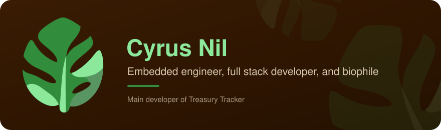
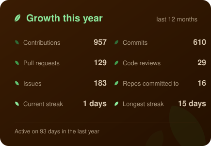
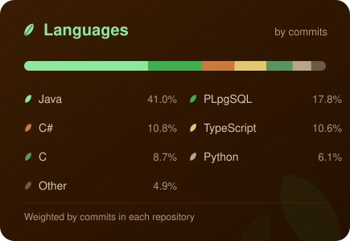
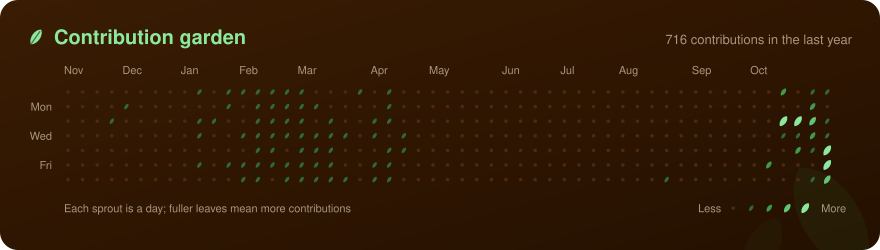
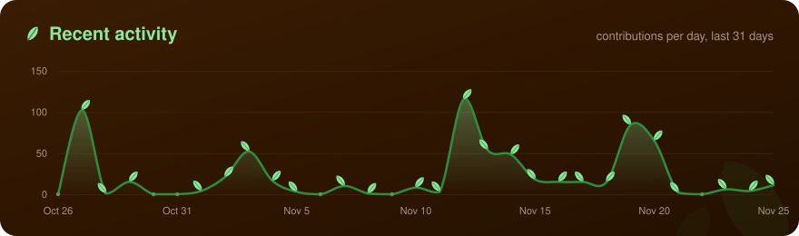

<p align="center">
  
</p>

## Hi, I'm Cyrus

I'm an embedded engineer, full stack developer, and biophile. I like things
that grow, whether that is a codebase, a piece of firmware, or a monstera on
the windowsill.

### Currently

- Firmware captain of [Longhorn Baja Racing](https://github.com/longhorn-baja-racing)
- Working on **Monstera Lang**, a custom embedded programming language

### Tools I reach for

<p>
  
  
  
  
  
  
  
  
  
  
</p>

### Growth

<p align="center">
  
  
</p>
<p align="center">
  
</p>
<p align="center">
  
</p>

<p align="center"><sub>Stats are refreshed daily and include private work as totals only.</sub></p>

```text
                        ############
                    #####################
                ###########################
             #############################
            #############################
            ###########################          ##
     ###     ########################        #######           cyrus@monstera
    ######      ###################      ###########           --------------
   #########       ###############   #############             OS: CachyOS Linux
  ############        ###########  #############       :::     Shell: zsh
 ################       ####################         ::::::    Editor: neovim
  ##################      ###############         ::::::::::   Focus: embedded, firmware
     ##########################:#######         ::::::::::::   Langs: C, C++, Rust
        #######################:#####        :::::::::::::::   Building: Monstera Lang
             #################::####     ::::::::::::::::::%   Hobbies: houseplants
####               ###########::#####::::::::::::::::::%%%%%
 ##########           #######:::########::::::::%%%%%%%%%%%    # nvim > emacs. Emacs is a
  ##############        #####:::#################%%%%%%%%%     # great operating system,
  ###########################:::############      %%%%%%%%     # it just lacks a decent
    ::::::::::###############:::########         %%%%%%%       # text editor.
     ::::::::::::############:::#####       %%%%%%%%%%%
       ::::::::::::::#######::::########%%%%%%%%%%%%%
          ::::::::::::::####::::######%%%%%%%%%%%%%
             :::::::::::::##::::####%%%%%%%%%%%%
                  :::::::::#::::###%%%%%%%%
                            ::::###
                             :::#
```
